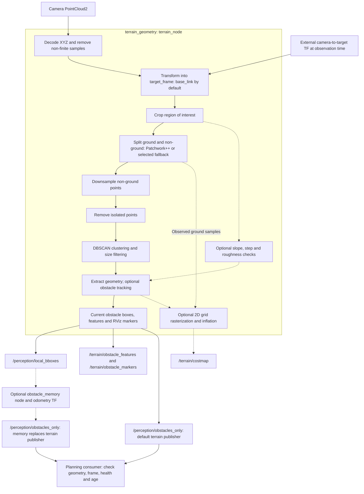
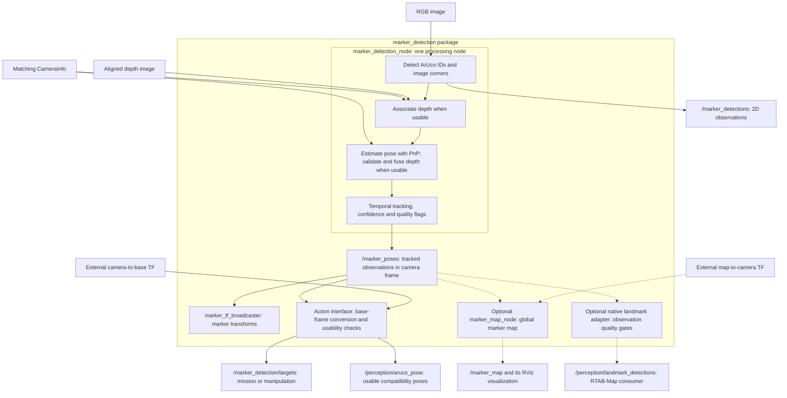

# Perception

Current status: package/regression checks pass; terrain ground classification
still fails controlled geometry checks, including with a matching height
reference. Positive camera-to-action/landmark acceptance also needs a suitable
scene. See [results and limits](INTEGRATION_REVIEW.md).

`Perception/` is an organizing folder. Its five ROS 2 packages are:

| Package | Owns |
| --- | --- |
| `perception_bringup` | Combined startup, combined RViz view and launch-contract checks |
| `terrain_geometry` | Terrain processing, optional obstacle memory, independent launches and terrain RViz |
| `marker_detection` | Marker detection/tracking, TF, action targets, optional mapping/landmark adapter and marker RViz |
| `terrain_geometry_msgs` | Terrain feature messages |
| `marker_detection_msgs` | Marker observation, tracking, mapping and action-target messages |

A package can contain several nodes. Internal image/cloud filtering helpers stay
in the processing nodes; making each helper a package would add unnecessary
communication and deployment boundaries.

## Inputs, processing stages and outputs

Gazebo, a physical camera or a testing feeder supplies the inputs. Perception
does not read a Gazebo world file or `/map` to identify ground; it processes the
camera observations. TF supplies coordinate relationships, not terrain labels.

| External input | Default topic / requirement | Used by |
| --- | --- | --- |
| Depth point cloud | `/camera/depth/color/points` (`sensor_msgs/msg/PointCloud2`) | Terrain |
| RGB image | `/camera/image_raw` (`sensor_msgs/msg/Image`) | Marker detection |
| RGB-aligned depth image | `/camera/depth/image_raw` (`sensor_msgs/msg/Image`) | Optional marker depth association/fusion |
| RGB calibration | `/camera/camera_info` (`sensor_msgs/msg/CameraInfo`), matching image dimensions | Marker 3D projection and pose estimation |
| TF and time | Calibrated camera-to-base TF; genuine localization TF for memory/mapping; `/clock` when `use_sim_time:=true` | Selected processing stages |

Terrain stages below are helper functions inside one `terrain_node`, not
separate ROS packages or nodes. Optional tracking, risk checks and memory do not
run by default; the combined launch also leaves grid generation off.



The ground split is a known failing validation stage, not a confirmed accurate
classifier. Optional terrain-risk checks need measured positive slope, step and
roughness limits plus a gravity reference. They do not make ground segmentation
validated. Ground/non-ground classification and safe traversability are separate
questions.



Solid arrows show data flow; dashed arrows mark optional paths, not extra
publishers that should run alongside the same authoritative output. TF, action,
mapping and landmark nodes independently consume tracked observations; they do
not form a required serial chain. Without usable calibration, RGB detection can
continue in 2D. Missing depth does not prevent calibrated monocular PnP.
Both branches publish diagnostics; see the output contracts below before using
their results.

## Start here

Use the software installed in `autonomous27:jazzy`, not host Python or ROS.
The [runbook](RUNBOOK.md) has Docker setup, isolated build commands, independent
and combined startup, sensor requirements and the complete launch inventory.
The [validation guide](TESTING_GUIDE.md) records checks and the testing-agent handoff.

```bash
# Inside the sourced Jazzy container, with sensors and calibrated TF available:
ros2 launch perception_bringup perception.launch.py use_sim_time:=true launch_rviz:=true
```

This starts terrain processing, marker detection/tracking, marker TF and action
targets. The camera driver, clock and localization are external. Use
`use_sim_time:=false` for wall-clock sources. Docker itself does not select time.
Optional mapping, memory, native landmarks, costmap and risk checks are not
started by the default combined launch. Their existing switches are preserved.

Independent entry points:

```bash
ros2 launch terrain_geometry terrain.launch.py use_sim_time:=false
ros2 launch marker_detection marker_branch.launch.py use_sim_time:=false launch_marker_mapping:=false
```

The old `ros2 launch terrain_geometry perception_system.launch.py` command
forwards to the new combined launch and requires `perception_bringup` installed.
It is a compatibility entry point, not terrain's dependency on marker processing.

## Run modes and options

First build and source the overlay using the [Docker runbook](RUNBOOK.md#1-open-an-isolated-validation-container).
For your existing Gazebo world, start the rover, camera bridge, calibrated TF and
simulation clock externally. Perception does not start those dependencies.
Use the normal GUI-enabled container for RViz; the runbook's isolated headless
container cannot see a Gazebo instance in another container.

Choose one processing mode; these commands are alternatives:

```bash
# Both branches plus combined RViz, using an existing simulation:
ros2 launch perception_bringup perception.launch.py use_sim_time:=true launch_rviz:=true
# Terrain only, using an existing simulation:
ros2 launch terrain_geometry terrain.launch.py use_sim_time:=true
# Marker branch only, without global marker mapping:
ros2 launch marker_detection marker_branch.launch.py use_sim_time:=true launch_marker_mapping:=false
```

Attach RViz to already-running processing with
`ros2 launch perception_bringup rviz.launch.py use_sim_time:=true`.
Stop a launch with Ctrl+C. Use `false` for wall-clock sensor inputs, and use the
same time basis for all participating nodes. Do not run multiple launches that
duplicate the same processing nodes, sensor publishers or TF authorities.

The following switches belong to `perception_bringup perception.launch.py`:

| Argument | Default | Effect / prerequisite |
| --- | --- | --- |
| `launch_terrain`, `launch_marker_branch` | `true`, `true` | Select either processing branch; disable the other for an isolated run |
| `launch_marker_detection`, `launch_marker_tf`, `launch_marker_action` | All `true` | Select marker stages; consumers need tracked observations if the detector is disabled |
| `launch_marker_mapping` | `false` | Start global marker mapping; requires genuine map-to-camera TF |
| `launch_landmark_adapter` | `false` | Publish accepted native landmark observations; SLAM runs separately |
| `launch_memory` | `false` | Retain local boxes in the configured memory frame; requires terrain and odometry TF; becomes the sole `/perception/obstacles_only` publisher |
| `enable_costmap` | `false` | Enable terrain grid rasterization and inflation |
| `enable_terrain_risk` | `false` | Requires `gravity_frame`, `max_slope_deg`, `max_step_m`, `max_roughness_m` set to the validated reference and limits |
| `launch_rviz`, `publish_debug_topics` | `false`, `false` | Start combined RViz / publish terrain debug clouds; enable their RViz displays separately |
| `input_pointcloud_topic`, `rgb_topic`, `depth_topic`, `camera_info_topic` | Input table above | Select provider topics; renaming depth does not align it to RGB |
| `target_frame`, `rviz_fixed_frame` | `base_link`, `base_link` | Terrain processing frame / RViz display frame; these are independent settings |
| `detection_params_file`, `tf_params_file`, `mapping_params_file`, `action_params_file`, `landmark_params_file`, `memory_params_file` | Packaged YAML files | Configure each selected node separately |

For example, add `enable_costmap:=true publish_debug_topics:=true` to the combined
command to enable its grid and debug outputs. Without localization, leave
mapping and memory off. The standalone marker branch retains a mapping-on
default, unlike combined bringup; pass `launch_marker_mapping` explicitly.
Changing terrain `target_frame` does not reconfigure marker action targets or
memory; their frames belong to their own YAML files.

List every argument and default before choosing a profile:

```bash
ros2 launch perception_bringup perception.launch.py --show-args
ros2 launch terrain_geometry terrain.launch.py --show-args
ros2 launch marker_detection marker_branch.launch.py --show-args
```

The independent terrain launch exposes filter, ground-backend and clustering
tuning beyond the combined launch. See the [complete launch inventory](RUNBOOK.md#2-inspect-or-start-production-processing)
and each package README for those parameters.

## Use mocked inputs separately

For an isolated run without Gazebo, build the existing `perception_test_tools`
package from `testing/mocks/perception/perception_test_tools` into the same
overlay. In the isolated validation container, run the feeder in one terminal
and real Perception in another, using the commands in the
[controlled-input guide](TESTING_GUIDE.md#controlled-production-message-flow).
That profile uses wall time, dedicated testing topics and explicit test-only
camera TF; it must not share those authorities with real sensors.

Alternatively, after building the same packages, the existing test wrapper starts
the feeder and selected real processing together:

```bash
ros2 launch perception_test_tools test_stack.launch.py pipeline:=all launch_rviz:=false
```

Use `pipeline:=terrain` or `pipeline:=markers` to select one branch. This is an
alternative to starting the feeder and processing separately. It reproduces the
existing fixture's limitations; it is not a passing accuracy acceptance profile.

The offline synthetic generator and timing runner under `testing/` are separate
from this live ROS feeder. See the [offline benchmark commands](../testing/benchmarking/perception/perception_benchmark_tools/README.md).
Neither synthetic processing nor a timing report establishes accuracy in your
Gazebo map; the known terrain and marker acceptance limits remain open.

## Data sent to other modules

| Topic | Type | Meaning |
| --- | --- | --- |
| `/perception/local_bboxes` | `vision_msgs/msg/Detection3DArray` | Current terrain observations in `target_frame` (default `base_link`) |
| `/perception/obstacles_only` | `vision_msgs/msg/Detection3DArray` | Terrain observations normally; retained odom-frame boxes when memory is selected |
| `/marker_detection/targets` | `marker_detection_msgs/msg/MarkerActionTargetArray` | Marker targets in the configured rover base frame; check freshness and usability |
| `/perception/landmark_detections` | `rtabmap_msgs/msg/LandmarkDetections` | Optional native SLAM observations with IDs, per-observation headers and covariance |
| `/perception/aruco_pose` | `geometry_msgs/msg/PoseStamped` | Compatibility pose output; lacks marker ID/covariance and is not the native SLAM interface |
| `/terrain/diagnostics`, `/marker_detection/diagnostics` | `diagnostic_msgs/msg/DiagnosticArray` | Processing health; consumers must also enforce message age |

An empty valid observation is different from unavailable perception. Do not infer
clear terrain from an empty topic, missing updates or a previously clear map.
After startup, inspect processing health and output headers/validity in the same
sourced container:

```bash
ros2 topic echo /terrain/diagnostics --once
ros2 topic echo /marker_detection/diagnostics --once
ros2 topic echo /perception/local_bboxes --once
ros2 topic echo /marker_detection/targets --once
```

These commands wait for messages; receiving a message does not prove correct
geometry. Targets require their usability/validity flags and fresh observation
time, and consumers must handle stopped updates. See the package READMEs and
[RViz observation checks](RUNBOOK.md#4-rviz-and-observation-checks).

The planner owns its box-to-cloud bridge. Perception does not start another one.
Current planner and SLAM source configurations match the obstacle and native
landmark topics; full navigation/SLAM behavior needs separate integration checks.

Runtime mock publishers, scenarios and artificial localization belong under the
master `testing/` folder. Per-package `test/` directories contain regression tests,
not runnable replacement dependencies. The offline terrain generator now lives
in `testing/mocks/perception/perception_test_tools`; its timing runner is the
`perception_benchmark_tools` package under `testing/benchmarking/perception/`.

See [terrain details](terrain_geometry/README.md), [marker details](marker_detection/README.md)
and [remaining validation limits](INTEGRATION_REVIEW.md). Older design documents
under `docs/` and `PerPro&Solu.md` describe historical proposals, not current startup
or evidence of physical accuracy.
