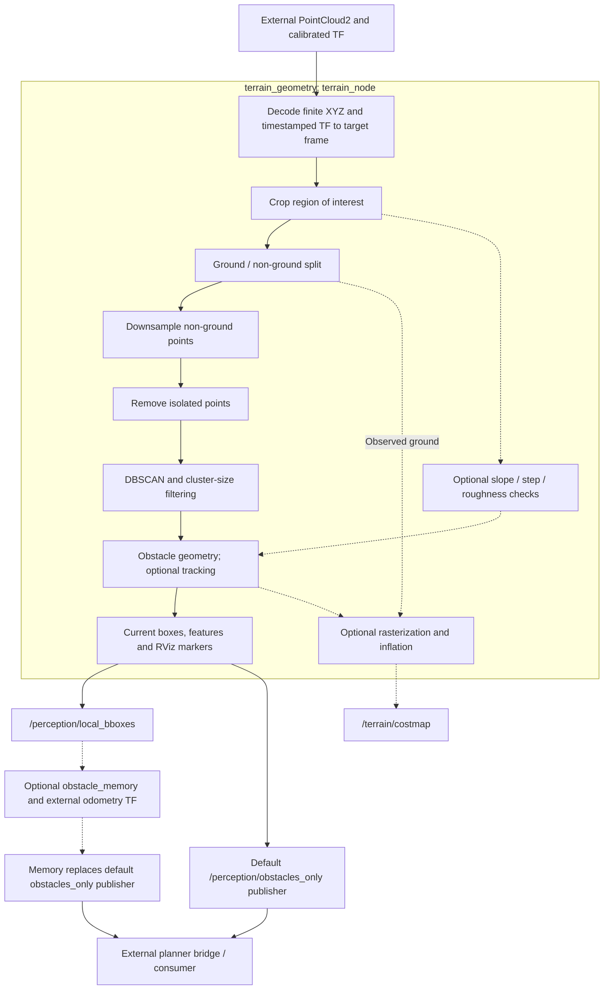
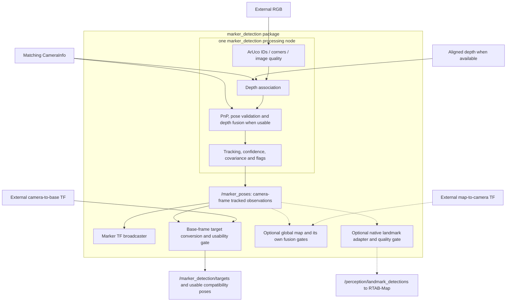

# Perception — module specification, interfaces and operating guide

**Read this file first.** This is the consolidated Perception reference for
agents and operators: scope, processing, packages, nodes, publishers/subscribers,
TF, configuration, launches, dependency mocks, test commands and pending work.
Reconciled against source at **`b053825`**, 20 November 2026, branch
`TestingValidation`. Commands use the unchanged **`autonomous27:jazzy`** Docker
image and its installed ROS/Python dependencies.

Use this file for routine operation and integration without rediscovering the
codebase. Before changing behavior, inspect the affected implementation and
update this file in the same change. Defaults below describe the documented
profile; remapping, YAML overrides and later source changes can alter them.
Inspect the live graph with `ros2 node info` / `ros2 topic info --verbose` when
checking a running system. Historical notes do not supersede this contract.

## 1. Current status, missing work and acceptance limits

| State | Established result or outstanding work |
| --- | --- |
| Implemented | Five production ROS packages; independent terrain/marker launches; combined bringup; three production RViz views; input/TF/health checks; stale action-target rejection; optional memory, global marker map, native landmarks and terrain-risk checks |
| Passed software checks | Most recent production-only live-profile build: eight packages including Rover, worlds and SLAM; five main launch argument inventories expanded; **177 pytest cases passed, one optional feeder check skipped** because the test package was absent. An earlier overlay including the feeder passed all **178** production pytest cases. |
| Prior runtime evidence | Production startup/shutdown, selected invalid-input/dropout recovery, controlled native landmark adapter publication and actual RViz rendering were checked in Docker. These checks do not establish scene accuracy. |
| Current standalone smoke check | Six-package build (production + Perception feeder), headless combined fixture, live boxes/tracks/diagnostics and dynamic debug-cloud enable passed without Rover, SLAM or PathPlanner. Marker 0 retained flag 128 (POSE_AMBIGUOUS); no new accuracy pass. All four production processing nodes exited cleanly on one launch interrupt. |
| FAILED: terrain geometry | Patchwork++ labels known synthetic floor points as obstacles. Of 9,120 floor points, 2,173 were rejected at Z=0; even with floor Z=-0.255 m and matching configured height, 605 were rejected. Changing origin height alone did not fix it. The combined rock/floor case also produces incorrect box geometry. |
| BLOCKED positive marker acceptance | Existing frontal fixture detects/tracks marker 0 and fuses depth, but retains `POSE_AMBIGUOUS`; action and native landmark gates correctly reject it. Need a suitable non-ambiguous, geometrically consistent scene or recording for a positive camera-to-target/SLAM check. |
| Completed mock cleanup | Offline generator moved to `testing/mocks/perception/perception_test_tools/perception_test_tools/terrain_scene.py`; runner moved to `testing/benchmarking/perception/perception_benchmark_tools`. No `terrain_geometry.benchmark` remains in production. |
| Pending investigation | Reproduce ground rejection in the existing Gazebo world/recording; distinguish raw-cloud/TF errors, native segmentation/configuration errors and downstream clustering/box errors. Preserve real rocks while reducing ground false positives. |
| Missing fixture coverage | Positive marker-action/landmark scene; runtime stale/future input and missing-TF/calibration scenarios beyond existing fixtures; agreed ground/slope/step truth and acceptance tolerances |
| FAILED: mock-only shutdown | `testing/mocks/perception/perception_test_tools/perception_test_tools/sensor_inputs.py` calls `rclpy.shutdown()` after SIGINT already shut the context down; normal launch stop reproduced `rcl_shutdown already called`, feeder exit 1. Testing-owner follow-up: catch shutdown interruption and use guarded/try_shutdown cleanup. Production nodes stopped cleanly; no testing source was changed here. |
| Pending integration | Real-world ground/rock geometry accuracy, global marker-map consistency, memory retention/clearing with validated ground, Nav2 marking/clearing and observation-loss policy, RTAB-Map landmark benefit, clock/reset recovery across modules |
| Decisions/calibration still needed | Measured sensor mounting/intrinsics and marker size, acceptable slope/step/roughness, geometry tolerances and target-computer latency budget. Configured defaults are not measured rover capability limits. |

Full Perception validation is **not complete**. An OK diagnostic, nonempty topic,
rendered RViz view or passing numerical test suite is not proof of correct ground
classification, usable marker targets, map quality or safe autonomous motion.
The [evidence record](INTEGRATION_REVIEW.md) contains experiment details.

## 2. Scope, packages and processing blocks

Perception converts externally supplied camera observations into local obstacle
geometry and marker observations/targets. It does not read a Gazebo world file
or `/map` to label ground, start camera drivers/simulators, estimate rover
odometry, plan paths, publish velocity commands or implement motor interlocks.
The named marker “action interface” publishes messages; it is **not a ROS action
server**. Production has no runtime dependency on testing or PathPlanner.

| Location / ROS package | Owns |
| --- | --- |
| `Perception/perception_bringup` / `perception_bringup` | Combined orchestration and combined RViz; no processing algorithm |
| `Perception/terrain_geometry` / `terrain_geometry` | One terrain processing node, optional memory node, terrain launch/RViz and processing helpers |
| `Perception/marker_detection` / `marker_detection` | One detector/PnP/tracker node; downstream TF, action interface, global map and landmark adapter nodes |
| `Perception/terrain_geometry_msgs` / `terrain_geometry_msgs` | ObstacleFeature and ObstacleFeatureArray definitions |
| `Perception/marker_detection_msgs` / `marker_detection_msgs` | 2D/3D observations, raw/tracked poses, action targets and global marker-map definitions |
| `testing/mocks/perception/perception_test_tools` / `perception_test_tools` | Live dependency feeder, fixture truth, mocked test wrapper/RViz and offline synthetic generator |
| `testing/benchmarking/perception/perception_benchmark_tools` / `perception_benchmark_tools` | Offline helper timing runner; not production-node or mission accuracy validation |

The first five rows are production packages. `Perception/` itself is an
organizing folder. Internal filters are in-memory functions, not separate ROS
nodes/packages. The existing terrain filters use NumPy/SciPy/scikit-learn and
native `pypatchworkpp` when selected/available. Markers use OpenCV ArUco/PnP,
NumPy, cv_bridge, generated messages and TF2. Native landmark publication requires
the Docker-installed `rtabmap_msgs`; RViz requires a GUI-enabled container.





Dashed paths are optional. TF, action, map and adapter nodes independently
consume tracked observations; marker TF does not have to arrive before the
action or map node can resolve a camera pose. Neither diagram proves accuracy.

## 3. Nodes, subscribers, rates and TF ownership

Names are the defaults used by the provided production launches; no namespace
is added. `R/V/N` below means Reliable, Volatile, Keep Last depth N;
`B/V/N` means Best Effort, Volatile, Keep Last depth N.

| Runtime node / executable | Explicit data subscriptions | Processing / publication trigger |
| --- | --- | --- |
| `/terrain_node` / `terrain_node` | PointCloud2 input, B/V/1 by default; TF2 listener | Each accepted cloud; diagnostics every 0.5 s in ROS time |
| `/obstacle_memory` / `obstacle_memory` | `/perception/local_bboxes`, R/V/10; `/terrain/debug/ground_cloud`, sensor QoS; TF2 listener | Observations update memory; output timer every 0.2 s (5 Hz) |
| `/marker_detection` / `marker_detection_node` | RGB, depth and CameraInfo, standard sensor QoS (B/V/5) | RGB drives detection; independent depth/calibration buffers; diagnostics default 1 Hz |
| `/marker_tf_broadcaster` / `marker_tf_broadcaster` | `/marker_poses`, R/V/10 | Each tracked array, publish eligible marker TF |
| `/marker_action_interface` / `marker_action_interface_node` | `/marker_poses`, R/V/10; TF2 listener | Each tracked array, publish targets and eligible compatibility poses |
| `/marker_map` / `marker_map_node` | `/marker_poses`, R/V/10; TF2 listener | Tracked arrays plus 1 Hz maintenance timer |
| `/marker_landmark_adapter` / `marker_landmark_adapter` | `/marker_poses`, R/V/10 | Each tracked array, including an empty result when no observations pass |

Cloud/image output rates depend on accepted input and processing time, not a
guaranteed FPS. Marker nodes do not create a sensor clock. ROS-time timers can
stop when simulation time stops. ROS parameter services and `/rosout` are normal
node infrastructure, not additional module data contracts.

| TF edge / service | Owner and contract |
| --- | --- |
| `base_link` to camera / IMU mounts | Real robot_state_publisher or calibrated driver/description; not Perception |
| Camera optical convention | +X right, +Y down, +Z forward. Terrain target/base convention is +X forward, +Y left, +Z up. Never merely relabel one as the other. |
| Current Gazebo sensor child | `my_robot/camera_link/camera` already comes from robot_state_publisher. Leave extra Rover/SLAM camera TF fallbacks disabled. Verify actual message headers. |
| `odom -> base_link` | Real localization/EKF for integration; existing mock feeder only in its explicit terrain-memory fixture profile |
| `map -> odom` | Real SLAM/localization; no production identity map anchor |
| Camera observation frame to `aruco_marker_<ID>` | Marker TF broadcaster; observation timestamp retained; confirmed-only default, predicted-lost publication disabled |
| `/tf`, `/tf_static` | TF2 transport; dynamic TF is volatile, static TF uses transient-local durability. There must be one authoritative publisher per TF edge. |
| `/marker_map/reset` (`std_srvs/srv/Empty`) | Optional marker_map node clears its in-memory global map and RViz markers, not the detector/tracker. Map is not persisted to disk. |

The current Rover description places `base_footprint` below `base_link` by the
model's 0.255 m offset. This is a model definition, not a measured floor height
on arbitrary terrain. RViz's Z=0 grid is only a drawing aid. A floor at a certain
absolute Z is not automatically an obstacle or automatically safe.

## 4. Complete explicit data-topic inventory

These are default names. Terrain's input is a launch argument; marker input and
most output names are node parameters. Adapter and memory topic names are
currently literal code defaults but can be remapped using normal ROS remapping.
The combined launcher does not expose every possible remapping/tuning parameter.

### 4.1 External inputs

| Topic / type | Publisher / subscribers | Contract |
| --- | --- | --- |
| `/camera/depth/color/points` — `sensor_msgs/msg/PointCloud2` | Camera/Gazebo -> terrain_node | Valid layout with scalar XYZ, finite samples; row padding and endianness handled. Header frame must resolve to terrain target at acquisition time. |
| `/camera/image_raw` — `sensor_msgs/msg/Image` | Camera/Gazebo -> marker_detection | Supported cv_bridge image encoding; meaningful source frame/stamp; RGB callback drives processing. |
| `/camera/depth/image_raw` — `sensor_msgs/msg/Image` | Camera/Gazebo -> marker_detection | Registered/aligned to RGB, matching dimensions; `32FC1` metres or `16UC1` / `mono16` scaled by `depth_scale` (default 0.001 m/unit). Renaming a raw topic does not register pixels. |
| `/camera/camera_info` — `sensor_msgs/msg/CameraInfo` | Camera/Gazebo -> marker_detection | Finite valid intrinsics, positive focal lengths and matching RGB dimensions; incompatible/invalid calibration must not be used for 3D projection/PnP. |
| `/clock` — `rosgraph_msgs/msg/Clock` | One simulator/bag clock -> all nodes configured with simulation time | Required only when `use_sim_time=true`; wall-time mocked feeder uses false and supplies no clock. |

### 4.2 Terrain outputs

| Topic / type | Publisher -> subscribers / intended consumers | QoS and condition |
| --- | --- | --- |
| `/perception/local_bboxes` — `vision_msgs/msg/Detection3DArray` | terrain_node -> optional memory, external observers | R/V/5; accepted current-frame observations, including a valid empty array |
| `/perception/obstacles_only` — `vision_msgs/msg/Detection3DArray` | terrain_node **or** memory -> external `erc_path_planner/costmap_bridge_node` and observers | Terrain R/V/5; memory R/V/10. Exactly one owner. Planner bridge publishes its own `/bridge/pointcloud`; it is not part of Perception. |
| `/terrain/obstacle_features` — `terrain_geometry_msgs/msg/ObstacleFeatureArray` | terrain_node -> observers/tools | R/V/5; current features |
| `/terrain/obstacle_markers` — `visualization_msgs/msg/MarkerArray` | terrain_node -> RViz | R/V/5; geometry markers or clearing markers; display controlled by `enable_marker_visualization` |
| `/terrain/costmap` — `nav_msgs/msg/OccupancyGrid` | terrain_node -> RViz/explicit external consumers | R/V/5; data only when `enable_costmap=true`; not a replacement for Nav2's own costmaps |
| `/terrain/debug/ground_cloud` — `sensor_msgs/msg/PointCloud2` | terrain_node -> RViz, memory ground-clearing callback | Sensor QoS; data requires `publish_debug_topics=true`; memory clearing additionally requires its own enable switch |
| `/terrain/debug/voxel_cloud` — `sensor_msgs/msg/PointCloud2` | terrain_node -> RViz/observers | Sensor QoS; filtered non-ground points before clustering; debug enabled only |
| `/terrain/debug/clustered_cloud` — `sensor_msgs/msg/PointCloud2` | terrain_node -> RViz/observers | Sensor QoS; colorized clusters, debug enabled only |
| `/terrain/diagnostics` — `diagnostic_msgs/msg/DiagnosticArray` | terrain_node -> health observers/consumers | R/V/5; 2 Hz while ROS time advances; input/processing freshness and health reason |

The three debug topics have publisher endpoints even when data publication is
disabled. Topic discovery alone does not establish usable traffic. There is no
separate custom `/terrain/costmap_updates`, `/cluster_labels` or `/clustered_cloud`
publisher in the unified node; actual clustered data is the debug topic above.

### 4.3 Marker outputs

Marker custom types in this table belong to `marker_detection_msgs/msg/`.
All explicit marker data publishers here use R/V/10; TF uses TF2's own profile.

| Topic / type | Publisher -> subscribers / intended consumers | Meaning / condition |
| --- | --- | --- |
| `/marker_detections` — `MarkerDetectionArray` | marker_detection -> observers/2D consumers | IDs, pixel corners/centres, area, detection confidence and quality flags |
| `/marker_3d_detections` — `Marker3DDetectionArray` | marker_detection -> observers | Depth-associated positions and depth statistics; inspect `valid_depth` / `valid_3d` |
| `/marker_poses_raw` — `MarkerPoseArray` | marker_detection -> observers | Per-frame PnP/pose validity, covariance, reprojection/depth agreement and quality |
| `/marker_poses` — `MarkerTrackedPoseArray` | marker_detection -> TF, action, optional map and adapter | Tracked camera-frame observations with per-marker header, state, validity, age, covariance and confidence |
| `/marker_detection/targets` — `MarkerActionTargetArray` | marker_action_interface -> external mission/manipulation/planning consumer | Base-frame pose/distances and usability gate; no mission consumer is started by Perception |
| `/perception/aruco_pose` — `geometry_msgs/msg/PoseStamped` | marker_action_interface -> compatibility consumers | One publication per usable target, source observation stamp; no ID/covariance. No active production consumer was found in the reviewed modules; retain compatibility. |
| `/perception/landmark_detections` — `rtabmap_msgs/msg/LandmarkDetections` | optional marker_landmark_adapter -> external RTAB-Map | Native plural interface; array and observation headers retained, camera-relative poses with 6x6 covariance. Adapter does not start SLAM. |
| `/marker_map` — `MarkerMap` | optional marker_map -> external map consumers | In-memory global marker estimates, state, covariance, counts and last_seen; output header is publication time |
| `/marker_map/visualization` — `visualization_msgs/msg/MarkerArray` | optional marker_map -> RViz | Map-frame arrows/labels when `publish_rviz_markers=true` |
| `/marker_detection/debug_image` — `sensor_msgs/msg/Image` | marker_detection -> RViz | 2D detection overlay when enabled |
| `/marker_detection/debug_3d_image` — `sensor_msgs/msg/Image` | marker_detection -> RViz | Depth-association overlay when enabled |
| `/marker_detection/pose_debug_image` — `sensor_msgs/msg/Image` | marker_detection -> RViz | Pose/axes overlay when enabled |
| `/marker_tracking/debug_image` — `sensor_msgs/msg/Image` | marker_detection -> RViz | Track state/confidence overlay when enabled |
| `/marker_detection/diagnostics` — `diagnostic_msgs/msg/DiagnosticArray` | marker_detection -> health consumers | Default 1 Hz; latency, input/calibration/synchronization and tracking statistics |

Debug publisher objects exist even if their corresponding images are disabled.
Competition mode suppresses debug image publication; it does not relax quality
gates. Downstream action/map/memory/adapter nodes do not have their own dedicated
health topics; do not infer their health from an old output message.

### 4.4 Payload and validity rules

| Output / input rule | Consumer requirement |
| --- | --- |
| Obstacle boxes | Use `header.frame_id` and acquisition stamp; sizes are X/Y/Z metres. Feature `depth` is X extent, `width` Y extent, `height` Z extent; feature centroid is the arithmetic mean, while an AABB box centre is its min/max midpoint. Do not assume they are identical. Default untracked cluster IDs are not persistent object identity. |
| Terrain unavailable versus clear | Valid observed empty arrays mean no detected obstacles in that observation. Missing, malformed, stale or untransformable input means unavailable, not clear. Enabled terrain grid becomes unknown (-1); previous box messages can remain in a consumer's cache. |
| Terrain timestamps | Input timeout 1 s by default; stale headers and headers more than 0.1 s in the future are rejected. The TF lookup uses observation time. Input receipt and last successful processing freshness are reported separately. |
| Grid values | Unknown -1, free 0, graded inflated costs up to occupied 100. Observed ground supports clearing/free evidence; unobserved cells remain unknown by default. |
| Memory | Output array frame defaults to `odom`; array header is current publication time, retained detections preserve observation headers. A 5 Hz array is not a new camera observation. TTL defaults to 5 s; source health and each observation's age still matter. Empty local observations do not instantly delete all retained boxes. |
| Marker RGB/calibration | RGB timeout 1 s; zero/future RGB rejected. CameraInfo receipt-age limit 5 s; invalid info clears previous calibration. No usable calibration means 2D can continue but calibrated 3D/PnP cannot. Missing depth permits calibrated monocular PnP. RGB/depth pairing tolerance defaults to 0.05 s. |
| Marker tracks | `NEW`, `CONFIRMED`, `DEGRADED`, `LOST`; inspect detection_valid/tracking_valid and flags. A confirmed track is not automatically actionable. Pose/covariance are camera-frame; quaternion order is x,y,z,w, distance metres, positional covariance m². |
| Action targets | `markers[]` contains marker_id, tracking_state, detected/stable, pose_valid, base-frame position/orientation, distances, confidence, flags, 3x3 covariance, age_seconds and usable_for_action. Require current header age as well as the explicit validity/usability gate. Invalid TF means invalid pose and NaN distances; default zero-valued message fields must not be treated as real positions. |
| Action freshness/gates | Default max age 0.5 s includes upstream age plus transport delay; min overall confidence 0.6, covariance trace at most 0.01 m². Covariance must be finite, symmetric, nonzero and positive semidefinite. Lost/degraded/outlier/ambiguous/stale/TF-unavailable flags disqualify action use. |
| Native landmarks | Require current confirmed valid track, min tracking confidence 0.6, valid frame/stamp and max total age 0.5 s; ID defaults to marker ID + 1, so mock ID 0 becomes native ID 1. Invalid covariance is rejected; all-zero covariance receives an explicit 0.04 m² diagonal position assumption. Angular variance defaults to 0.1 rad². These are configured assumptions, not measured uncertainty. Native and action gates are not identical. |
| Global marker map | Separate confidence/reprojection/innovation gates and confirmation state; do not assume action usability/freshness gates were applied. Read each entry's state and last_seen, not just the array publication stamp. Default stale timeout 30 s; no disk persistence. |
| Stopped clock / publisher | Consumers need independent observation-loss handling. ROS-time diagnostic timers can freeze; stopped target publication does not promise a final invalidation message. Full end-to-end clock reset remains an integration gate. |

Marker flag bits: LOW_DEPTH_QUALITY=1, LOW_IMAGE_QUALITY=2,
LOW_MARKER_RESOLUTION=4, HIGH_VIEWING_ANGLE=8, HIGH_REPROJECTION_ERROR=16,
DEPTH_MISMATCH=32, TEMPORAL_OUTLIER=64, POSE_AMBIGUOUS=128, STALE_DATA=256,
TRACK_DEGRADED=512, TRACK_LOST=1024, TF_UNAVAILABLE=2048,
MULTIPLE_INSTANCES_SAME_ID=4096. Zero means no flags, not automatic actionability.

## 5. Launch inventory, defaults and configuration

All `ros2` commands in this file run inside the sourced Jazzy container.
No new launch behavior is introduced by this document.

| Package / launch file | Starts | Default clock / required external inputs |
| --- | --- | --- |
| `perception_bringup perception.launch.py` | Terrain + detector/tracker + marker TF + action interface; optional stages below | true; camera, calibration, mounting TF, advancing `/clock` |
| `perception_bringup rviz.launch.py` | Combined RViz only | false; GUI/data/TF |
| `terrain_geometry terrain.launch.py` | terrain_node only | true; cloud and sensor-to-target TF |
| `terrain_geometry obstacle_memory.launch.py` | memory only | false; local boxes and memory-frame TF |
| `terrain_geometry rviz.launch.py` | Terrain RViz only | false; GUI/data/TF |
| `terrain_geometry perception_system.launch.py` | Compatibility forwarding to combined bringup | Same as combined; `perception_bringup` must be installed |
| `marker_detection marker_detection.launch.py` | Detector, depth association, PnP and tracking in one node | true; RGB, calibration for poses, aligned depth for fusion |
| `marker_detection marker_tf.launch.py` | Marker TF consumer | true; tracked poses |
| `marker_detection marker_action_interface.launch.py` | Action targets and legacy usable poses | true; tracked poses and camera-to-base TF |
| `marker_detection marker_mapping.launch.py` | Global marker map | true; tracked poses and genuine map-to-camera TF, not a required marker-TF broadcaster |
| `marker_detection landmark_adapter.launch.py` | Native landmark adapter | false; tracked poses and installed native message definitions |
| `marker_detection marker_branch.launch.py` | Detector + TF + action + global mapping by default; adapter off | true; disable mapping explicitly if localization is absent |
| `marker_detection rviz.launch.py` | Marker RViz only | false; GUI/data/TF |

Pass `use_sim_time` explicitly. Combined bringup forwards one selected clock to
every included stage. Individual marker launches accept `params_file`; the branch
and combined launch have separate per-node parameter-file arguments.

### Combined launch arguments

| Argument | Default / effect |
| --- | --- |
| `use_sim_time` | true; false for the existing wall-time test feeder / wall-time camera |
| `launch_terrain`, `launch_marker_branch` | true, true |
| `launch_marker_detection`, `launch_marker_tf`, `launch_marker_action` | true each; disabled detector requires another tracked-pose source for its consumers |
| `launch_marker_mapping`, `launch_landmark_adapter`, `launch_memory` | false each; memory requires terrain in this combined launcher |
| `launch_rviz`, `enable_costmap`, `enable_terrain_risk`, `publish_debug_topics` | false each |
| `input_pointcloud_topic`, `rgb_topic`, `depth_topic`, `camera_info_topic` | Input names from section 4.1 |
| `target_frame`, `rviz_fixed_frame` | base_link, base_link; changing terrain frame does not change marker action or memory frames |
| `gravity_frame`, `max_slope_deg`, `max_step_m`, `max_roughness_m` | odom, 0.0, 0.0, 0.0; enabled risk needs a valid gravity reference and positive measured limits (slope below 90°) |
| `rviz_config` | `perception_bringup/rviz/perception_system_view.rviz` |
| `detection_params_file` | `marker_detection/config/marker_detection.yaml` |
| `tf_params_file` | `marker_detection/config/marker_tf.yaml` |
| `mapping_params_file` | `marker_detection/config/marker_mapping.yaml` |
| `action_params_file` | `marker_detection/config/marker_action_interface.yaml` |
| `landmark_params_file` | `marker_detection/config/landmark_adapter.yaml` |
| `memory_params_file` | `terrain_geometry/config/obstacle_memory.yaml` |

### Important processing defaults and tuning boundaries

| Stage | Current defaults / limits |
| --- | --- |
| Terrain ROI | Enabled; X [0.2,8], Y [-4,4], Z [-0.5,1.5] m in target_frame |
| Terrain TF/input | timeout 0.2 s; input queue depth 1; static transform cache disabled by default |
| Ground backend | `auto`: native Patchwork++ when importable, otherwise explicit logged fallback. `patchwork` requires native; `fallback` explicitly selects NumPy. Do not change backend silently to claim a geometry pass. |
| Ground configuration | origin/sensor height 0.2 m; 4 zones; XY range 0.2–10 m. `ground_height_threshold=0.15` affects the fallback only, not native Patchwork++ tuning. |
| Downsampling/outliers | 0.05 m leaf sizes; radius filter enabled, 0.2 m search radius, 5 neighbors |
| Clustering | DBSCAN enabled, eps 0.3 m, min points 5, cluster size 10–50000; OBB disabled, obstacle visualization enabled |
| Terrain tracking | Off; association distance 0.5 m, max missed frames 3, position smoothing 0.5 when enabled |
| Terrain grid | Off; 200x200 at 0.05 m, origin (0,-5,0), unknown space on; forward extent 10 m |
| Inflation | robot_radius 0.3 m, inflation radius 0.6 m, scaling 10; unknown inflation off; these are configured geometry, not accepted rover safety dimensions |
| Standalone terrain debug | true, unlike the combined launch's false; optional profiling false, log interval 30 frames |
| Marker identity/PnP | DICT_4X4_50, side length 0.21 m, IPPE_SQUARE, reprojection limit 3 px; allowed ID list empty means unrestricted; per-ID size overrides disabled |
| Depth | 0.15–10 m; minimum valid samples 20; 16UC1 scale 0.001; default depth/PnP discrepancy limit 0.20 m |
| Tracking | 3 confirmations within 1 s; degradation after 0.5 s, lost after 1.5 s, deletion after 5 s; additional quality/innovation gates remain active |
| Marker map | 5 global confirmations, stale after 30 s, min tracking confidence 0.30, reprojection limit 3 px; reset service only clears the global map |
| Memory | frame odom, TTL 5 s, association 0.5 m, accepted input age 1 s; ground clearing false. Keep clearing disabled until ground geometry is accepted. |
| Debug/competition | Normal marker YAML enables debug images and diagnostics; competition profile suppresses images/logging but preserves quality gates. |

The independent terrain launch exposes all its filter/grid arguments; combined
bringup intentionally exposes a smaller set. Marker algorithm knobs belong to
the detection YAML, not arbitrary combined-launch arguments. Keep separate YAML
node scopes; the competition YAML is an override profile, not a new algorithm.
Most algorithm settings are read at startup: do not assume an accepted ROS
parameter change rebuilt cached processing objects. The terrain node explicitly
handles hot changes for `enable_obb`, `publish_debug_topics`, `enable_costmap`
and `publish_to_obstacles_only`; use startup arguments/YAML and restart for other
terrain tuning. Changing publisher ownership manually still requires ensuring
exactly one producer for that output.
Inspect installed arguments if a parameter is not listed above:

```bash
ros2 launch perception_bringup perception.launch.py --show-args
ros2 launch terrain_geometry terrain.launch.py --show-args
ros2 launch marker_detection marker_branch.launch.py --show-args
```

## 6. Which mocks are needed?

**No PathPlanner mock is needed to test Perception on its own.** The actual
existing path is plural `testing/mocks/perception/`, not a new
`testing/mock/pathplanner` directory. A planner is an output consumer, not a
required upstream dependency. Mocking Perception's own obstacle output would
test the consumer, not Perception.

| Profile | Needed upstream dependency / existing provider |
| --- | --- |
| Terrain alone | PointCloud2 + calibrated camera-to-target TF; existing Perception sensor feeder supplies both |
| Marker detection/tracking | RGB + matching CameraInfo; depth optional for fusion; existing feeder supplies all three |
| Marker base-frame targets | Above plus camera-to-base TF; supplied by the same feeder |
| Terrain memory | Above plus odom-to-base TF; `test_stack.launch.py pipeline:=terrain launch_memory:=true` enables the feeder's known test rotation, with no real EKF in that isolated graph |
| Native adapter contract | Real tracked observations -> native messages; no running SLAM required merely to inspect publication. Positive camera-to-landmark fixture remains missing. |
| Global marker mapping / real SLAM ingestion | Genuine localization for integration, or a separately agreed coherent localization fixture for a limited contract check. Current recommended standalone feeder does not supply a global map reference. |
| Gazebo profile | No mocks: world/rover supply camera streams and mounting TF; SLAM added only for optional global/memory integration |

### Existing live feeder contract

| Mock topic | Type / QoS / meaning |
| --- | --- |
| `/testing/perception/camera/points` | PointCloud2, sensor QoS; synthetic optical-frame points |
| `/testing/perception/camera/image_raw` | Image bgr8, sensor QoS; synthetic ArUco RGB |
| `/testing/perception/camera/depth` | Image 32FC1 metres, sensor QoS; absent for missing_depth |
| `/testing/perception/camera/image_info` | CameraInfo, sensor QoS; 640x480, fx=fy=600, cx=320, cy=240 |
| `/testing/perception/ground_truth` | MarkerArray, R/V/10; expected rock overlay for observers/RViz only, not production algorithm input |
| Test mounting TF | base_link -> test_camera_optical_frame, translation (0.2,0,0.4) m and optical rotation; artificial fixture calibration, not the rover's measured mount |
| Optional test motion TF | odom -> base_link only when synthetic_motion=true; never run alongside real EKF/simulator TF for that edge |

Default feeder is 10 Hz, seed 0, wall time. Its rate/seed can be set as node
parameters; the wrapper exposes scenario/motion, not every node parameter.
The fixture floor is at base_link Z=0; rock bounds approximately
X [1.8,2.2], Y [0.4,0.8], Z [0.05,0.45] m, centre (2,0.6,0.25).
Marker 0 is drawn frontally at nominal optical depth 2 m. This is a deterministic
fixture, not a physically calibrated multi-sensor scene or accepted rover truth.

| Scenario | Intended check / current limitation |
| --- | --- |
| `rocks_and_marker` | Nominal traffic; current native terrain box geometry fails and marker remains ambiguous |
| `ground_only` | No fabricated obstacle on a known floor; currently fails native ground classification |
| `missing_depth` | RGB detection/calibrated monocular PnP can continue without depth fusion; positive pose acceptance is not guaranteed |
| `invalid_cloud` | All-NaN cloud -> unavailable terrain, enabled grid unknown, no fabricated valid empty observation |
| `dropout` | Feeder pauses all sensor publication periodically while wall time advances; check stale-input diagnosis and recovery |
| `turn_occlusion` | Periodic removal/reappearance of marker/rock; inspect tracking transitions and recovery |
| `terrain_hazard` | Synthetic raised slope patch; risk decisions need an explicitly configured/accepted gravity and limit profile |

The separate `terrain_scene.synthetic_frames` generator creates offline arrays,
not ROS traffic; its benchmark only reports helper timing/point counts. Existing
`legacy_map_anchor.launch.py` adds an artificial identity map anchor and does not
provide the sensor fixture. It is not the recommended acceptance launcher and
must not run beside real SLAM. No new mocks are implemented by this handoff.

## 7. Run and test Perception alone, without Gazebo

This is the shortest way to see the real production branches process controlled
inputs. It does not require Rover, SLAM or PathPlanner. Geometry failures in
section 1 are expected to remain visible, not converted into passing claims.

### 7.1 Docker, build and terminal setup

On the host, start the existing GUI-enabled project container if not running:

```bash
cd /home/saif/Desktop/MESEKET/Autonmous-27/Autonmous_Ws
bash docker/run_docker.sh
```

Inside Docker, build six explicitly selected source packages/directories:

```bash
source /opt/ros/jazzy/setup.bash
cd /workspace
colcon --log-base /tmp/perception-info/log build --symlink-install \
  --base-paths /workspace/Perception /workspace/testing/mocks/perception/perception_test_tools \
  --build-base /tmp/perception-info/build --install-base /tmp/perception-info/install \
  --cmake-args -DBUILD_TESTING=OFF
```

For each extra host terminal:

```bash
docker exec -it autonomous27_container bash
```

Run in every container terminal, including the first:

```bash
source /opt/ros/jazzy/setup.bash
source /tmp/perception-info/install/setup.bash
export ROS_DOMAIN_ID=93
cd /workspace
```

Use terminal A for a selected test launch and B for checks. Keep a single test
launch running. Ctrl+C stops that launch before changing scenario/branch.
`launch_rviz:=true` requires this GUI-enabled container; use false headlessly.
Do not start Gazebo/real sensors in this test domain.

### 7.2 Terrain fixture and real terrain node

Terminal A:

```bash
ros2 launch perception_test_tools test_stack.launch.py \
  pipeline:=terrain scenario:=ground_only launch_rviz:=true
```

Terminal B:

```bash
ros2 param set /terrain_node publish_debug_topics true
ros2 topic echo /terrain/diagnostics --once
ros2 topic echo /perception/local_bboxes --once
ros2 topic info /perception/obstacles_only --verbose
```

In RViz use fixed frame base_link, compare test truth/raw points, ground cloud,
clustered cloud and boxes; add/enable debug displays as needed. The desired
ground-only result is valid empty boxes with healthy processing. Current native
ground output fails that geometry condition even when health is OK. Stop A and
repeat with `scenario:=rocks_and_marker`, requiring the box to match the known
rock rather than include the floor. Do not change backend to hide the failure.

### 7.3 Marker branch, local TF and action interface

Stop A's terrain test first. In A:

```bash
ros2 launch perception_test_tools test_stack.launch.py \
  pipeline:=markers scenario:=rocks_and_marker launch_rviz:=true
```

In B:

```bash
ros2 topic echo /marker_detections --once
ros2 topic echo /marker_poses --once
ros2 topic echo /marker_detection/targets --once
ros2 topic echo /marker_detection/diagnostics --once
```

Expect ID 0 detection/tracking and inspect flags/depth_fused. The current fixture
is rejected as POSE_AMBIGUOUS for action use; do not call this a positive target
acceptance pass. In RViz inspect detection debug images and TF. Re-run with
`scenario:=missing_depth` to check that RGB processing continues without fusion.

### 7.4 Combined and input-loss checks

Stop A and run:

```bash
ros2 launch perception_test_tools test_stack.launch.py \
  pipeline:=all scenario:=dropout launch_rviz:=true
```

Observe both diagnostics through repeated loss/recovery. Terrain must become
unavailable, not report the missing view as clear; the wrapper enables the grid,
which should become unknown during loss. Targets must not be treated as current
when headers age; output may stop. Re-run `scenario:=invalid_cloud` for malformed
cloud rejection. Return to `rocks_and_marker` to confirm traffic recovery.
Pausing Gazebo is a different test because it also stops simulation time.

Optional isolated memory smoke profile, with all other test launches stopped:

```bash
ros2 launch perception_test_tools test_stack.launch.py \
  pipeline:=terrain scenario:=rocks_and_marker launch_memory:=true launch_rviz:=true
```

The wrapper only permits mock memory motion with pipeline=terrain. Check one
obstacles_only publisher and odom-frame retained detections. Incorrect upstream
terrain geometry still prevents a meaningful memory accuracy acceptance claim.

### 7.5 Software regression checks

Stop the fixture launch first. Run regression checks in a sourced container
terminal using a separate ROS domain so test-created nodes cannot collide with
your demonstration graph:

```bash
export ROS_DOMAIN_ID=94
python3 -m pytest /workspace/Perception/perception_bringup/test \
  /workspace/Perception/terrain_geometry/test \
  /workspace/Perception/marker_detection/test -q -p no:cacheprovider
```

Earlier overlays with the feeder built passed 178 production pytest cases.
Some feeder-package integration tests additionally need the real planner bridge;
that is downstream integration, not a reason to add a PathPlanner dependency to
this standalone profile. Record current results and skips rather than copying
an older count as fresh evidence.

## 8. Existing Gazebo world, Rover and real Perception

Stop all test launches. Use the same GUI container with a different domain,
92, in every live-profile terminal. No mocks are needed for this profile.

### 8.1 Build and source the live overlay

```bash
source /opt/ros/jazzy/setup.bash
cd /workspace
colcon --log-base /tmp/perception-live/log build --symlink-install \
  --paths worlds Rover/my_robot_description SLAM/rover_slam \
    Perception/terrain_geometry_msgs Perception/marker_detection_msgs \
    Perception/terrain_geometry Perception/marker_detection Perception/perception_bringup \
  --build-base /tmp/perception-live/build --install-base /tmp/perception-live/install \
  --cmake-args -DBUILD_TESTING=OFF
```

In **every** live container terminal:

```bash
source /opt/ros/jazzy/setup.bash
source /tmp/perception-live/install/setup.bash
export ROS_DOMAIN_ID=92
cd /workspace
```

### 8.2 World and Rover in terminal A

```bash
ros2 launch my_robot_description gazebo.launch.py \
  'world:=final_world_R&A.world' \
  publish_map_tf:=false publish_camera_tf:=false bridge_sim_tf:=false
```

This is the world selected in the SLAM review. Quote the ampersand-containing
filename. The launch starts the world, spawns the rover, publishes its model TF
and bridges sensors/clock. Do not spawn it again or start another camera TF owner.
Local Perception uses base_link and does not require SLAM at this stage.

In a checks terminal, wait for the rover to settle, then run:

```bash
ros2 topic echo /clock --once
ros2 topic echo /camera/depth/color/points --field header --once --qos-reliability best_effort
ros2 topic echo /camera/image_raw --field header --once --qos-reliability best_effort
ros2 topic echo /camera/depth/image_raw --field encoding --once --qos-reliability best_effort
ros2 topic echo /camera/camera_info --field k --once --qos-reliability best_effort
ros2 run tf2_ros tf2_echo base_link my_robot/camera_link/camera --ros-args -p use_sim_time:=true
```

Use the actual camera header frame if different. Require advancing clock/source
stamps, valid calibration and resolvable mounting TF before judging Perception.
Use `ros2 topic hz TOPIC` for cadence and Ctrl+C to stop it; no fixed throughput
is claimed by this guide.

### 8.3 Terrain, markers and combined modes

Start one processing command at a time in B, with its RViz in C:

```bash
# Terrain only, terminal B:
ros2 launch terrain_geometry terrain.launch.py use_sim_time:=true \
  enable_costmap:=true publish_debug_topics:=true
```

```bash
# Terrain view, terminal C:
ros2 launch terrain_geometry rviz.launch.py use_sim_time:=true
```

Enable Robot Model, Debug Ground Cloud, Debug Clustered Cloud and Terrain
Costmap; add `/terrain/debug/voxel_cloud` if needed. Compare a known clear patch,
rock and gentle rise at different viewpoints. Floor in the raw cloud at the
wrong orientation/location means inspect geometry/TF first. Correct raw floor
labelled non-ground means segmentation. Correct labelled points but wrong boxes
means downstream clustering/features. Record the failing view rather than tune
until a single image looks acceptable.

Stop B/C before switching. To inspect detector/tracker alone:

```bash
ros2 launch marker_detection marker_detection.launch.py use_sim_time:=true
```

Stop that detector before starting the full local marker branch in B:

```bash
ros2 launch marker_detection marker_branch.launch.py use_sim_time:=true \
  launch_marker_mapping:=false launch_landmark_adapter:=false
```

View in C:

```bash
ros2 launch marker_detection rviz.launch.py use_sim_time:=true
```

Check a visible known marker's ID, scale, tracking, covariance, flags, base-frame
pose/distances and usability. Hide/reveal it to check aging and recovery. A scene
with no compatible visible marker cannot establish positive detection/pose
acceptance. Optional teleoperation uses another sourced terminal:

```bash
ros2 run my_robot_description teleop_gui.py
```

Stop B/C before the combined profile, which starts RViz itself:

```bash
ros2 launch perception_bringup perception.launch.py use_sim_time:=true \
  launch_rviz:=true enable_costmap:=true publish_debug_topics:=true
```

Repeat both branches' checks stationary and during slow translation/turns.
Do not run a navigation command source simultaneously with manual teleoperation.

### 8.4 Optional SLAM, memory, map and landmark boundaries

For genuine global/memory integration, start SLAM in another sourced terminal
after the sensor checks. This uses the existing defaults, not a new fusion fix:

```bash
mkdir -p /tmp/perception-live/results
ros2 launch rover_slam slam_bringup.launch.py use_sim_time:=true \
  odom_topic:=/odom launch_encoder:=false launch_rviz:=false \
  launch_static_tf:=false launch_camera:=false launch_costmap:=false \
  database_path:="/tmp/perception-live/results/rtabmap_$(date +%Y%m%d_%H%M%S).db"
```

SLAM has its own documented accuracy/reset issues; a connected TF tree does not
prove correct localization. Check odom-to-base and map-to-camera TF before their
consumers. Restart combined Perception with one optional switch at a time:

| Add to combined command | Required check |
| --- | --- |
| `launch_landmark_adapter:=true` | `/perception/landmark_detections` headers, accepted IDs/covariance and actual RTAB-Map subscription/ingestion; empty arrays verify only rejection/traffic, not positive acceptance or map benefit |
| `launch_memory:=true` | One `/perception/obstacles_only` publisher, frame odom by default, observation-age/TTL behavior, loss/recovery and odometry consistency |
| `launch_marker_mapping:=true` | Map-frame estimates remain consistent for a stationary marker while rover moves; inspect entry last_seen/state and localization quality |
| `enable_terrain_risk:=true` | Do not select until positive measured slope/step/roughness limits and gravity reference are agreed; zero defaults deliberately do not form a working risk profile |

None of these requires a PathPlanner mock. Testing the planner's downstream
response is a separate integration profile.

## 9. Observe, record, shut down and maintain this contract

Routine checks, one command at a time in the relevant sourced/domain terminal:

```bash
ros2 node list
ros2 node info /terrain_node
ros2 node info /marker_detection
ros2 topic info /perception/obstacles_only --verbose
ros2 topic echo /terrain/diagnostics --once
ros2 topic echo /marker_detection/diagnostics --once
ros2 topic echo /perception/local_bboxes --once
ros2 topic echo /marker_detection/targets --once
ros2 interface show marker_detection_msgs/msg/MarkerActionTarget
ros2 interface show terrain_geometry_msgs/msg/ObstacleFeature
```

Enable optional views only after their producers/TF exist. Production RViz has
no fixture truth overlay; the test wrapper uses its separate truth view. The
normal combined view starts with fixed frame base_link. `rviz_fixed_frame`
belongs to combined bringup; standalone RViz uses `fixed_frame`. Sensor displays
use Best Effort. Map/costmap/debug and RobotModel displays may start disabled.

Record a bounded real-scene failure with sensors, time, TF and relevant outputs:

```bash
mkdir -p /tmp/perception-live/results
ros2 bag record --use-sim-time -o "/tmp/perception-live/results/perception_$(date +%Y%m%d_%H%M%S)" \
  /clock /tf /tf_static /camera/image_raw /camera/depth/image_raw \
  /camera/camera_info /camera/depth/color/points /imu/data /odom \
  /terrain/diagnostics /perception/local_bboxes /terrain/debug/ground_cloud \
  /terrain/debug/voxel_cloud /marker_detections /marker_poses \
  /marker_detection/targets /marker_detection/diagnostics
```

Use `--use-sim-time` for this Gazebo profile so bag storage timestamps share the
sensor clock; otherwise replay's generated clock can disagree with acquisition
headers and trigger stale-input rejection. Wait for `/clock` before recording.
Ctrl+C stops recording; inspect `ros2 bag info BAG_DIRECTORY`, including TF,
before replay. Replay input topics in a separate profile with original sources
stopped, not recorded Perception outputs alongside newly computed outputs.
Recordings can be large; keep them outside source packages and bounded in time.
The offline benchmark's SQLite3 reader does not replay TF or transform optical
points; it must not be used as if it performed this end-to-end replay.

Stop teleoperation with zero velocity, then recording/Perception/RViz, optional
SLAM, and the world launch using Ctrl+C. Stop only this run's processes. Do not
use global `pkill` or erase shared build/install/log directories. Keep the main
container shell open while other terminals depend on its `--rm` container.

On changes, update this file's node/topic tables, frames/QoS/defaults, launch
profiles, mock contracts and explicit pass/fail/pending evidence together.
The README points here; [RUNBOOK.md](RUNBOOK.md) and
[TESTING_GUIDE.md](TESTING_GUIDE.md) retain detailed procedures/history, and
[INTEGRATION_REVIEW.md](INTEGRATION_REVIEW.md) retains measured failures.
