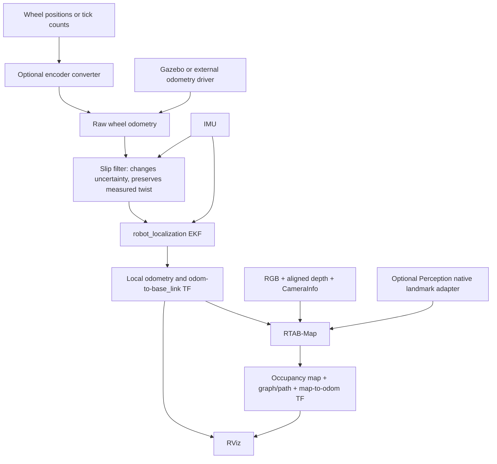

# SLAM — module specification and operating guide

**Read this file first.** It consolidates the module's architecture, packages,
interfaces, launch choices, dependency mocks, run commands and outstanding work.
Reconciled with source at `b053825`, 20 November 2026, on `TestingValidation`.
SLAM implementation/evidence checkpoint: `edf9185`; standalone documentation:
`93011f0`. Later shared-branch commits are preserved.

Use this file for routine operation and agent handoff. Before changing behavior,
inspect the affected implementation and update this file in the same change.
[VALIDATION.md](VALIDATION.md) preserves detailed historical evidence; older task
documents do not override the readiness states below. This is a consolidated
reference, not a promise that future code changes cannot make it stale.

## 1. Current status and open decisions

| State | Evidence / next action |
| --- | --- |
| Implemented | One production package; independent component launches and combined master; runtime mocks outside production; local/global RViz profiles; wheel timing, input rejection, covariance and TF fixes |
| Passed checkpoint | Production-only build/startup without testing packages; 60 regression tests with zero skips; 8/8 local mocked input/loss/recovery contracts; Gazebo sensor interfaces; both RViz profiles rendered |
| Passed bounded Gazebo recovery | RGB interruption stopped mapping updates while local odometry continued; mapping resumed after RGB restoration |
| Failed: current turn consistency | Ideal fixture max position error 0.32646 m using forward + lateral acceleration; forward-only scratch profile 0.00280 m. Both passed the input contracts. This is not physical accuracy evidence. |
| Failed: remaining Gazebo accuracy | Separate native-truth runs: production max local/global error 0.5840/0.5367 m; forward-only candidate 0.2548/0.2512 m. Different runs, not identical recorded-sensor replay. No accuracy pass assigned. |
| Failed: clock reset | Simulator reset accepted; no new-clock EKF odometry or RTAB-Map Info updates observed during ten subsequent wall seconds. Exact fault location remains unresolved. |
| Reported integration failure | PathPlanner PP12 reports a stationary rover near its origin while EKF ends near (-1.39, 86.96) m. This is a diagnostic mismatch, not a timestamp-aligned score; not independently reproduced in this documentation change. See [PathPlanner evidence](../PathPlanning/VALIDATION.md). |
| Failed: optional startup/shutdown | Costmap activation without required map TF aborted on shutdown; some Gazebo servers required scoped shutdown escalation |
| Blocked | Physical RealSense startup: prescribed image lacks `realsense2_camera`; physical sensor calibration/device checks are unavailable |
| Untested / unvalidated | Map-surface accuracy, successful loop closure, positive real-camera landmark acceptance, full TF publisher-authority tracing, hardware, full live RViz data acceptance and mission-level accuracy |
| Open decision | Production EKF still fuses IMU yaw, yaw rate, acceleration X **and Y**. Forward-only acceleration is a candidate, not an approved default. Do not change the mask automatically. |
| Missing criteria/tooling | Agree trajectory/map acceptance bounds; isolate remaining drift/reset failures; add maintained independent-truth accuracy tooling and a coherent moving RGB-D mock if needed |

Encoder + IMU fusion works while turning. The isolated concern is the lateral
acceleration channel in the present unconstrained lateral-motion model, not
whether wheels and IMU can be fused. Do not invent a zero-sideways-velocity
measurement to force a pass: the skid-steer rover can actually slip sideways.
Terrain/slopes, wheel calibration and sensor errors still require isolation.

Recorded historical raw artifacts lived under `/tmp/codex-slam-validation.FoJgcD`.
That directory was **absent on this host when this file was written**. The
measurements above are preserved review results, not fresh reruns. Historical
scratch Gazebo drivers/YAMLs are not installed tools; commands in this file use
maintained source tools or explicitly describe the remaining measurement work.
Use persistent artifact storage for new runs as below.

## 2. Scope, packages and architecture

SLAM estimates planar local motion and constructs a camera/depth-based global
map. It does not implement motor control, navigation, terrain classification or
a physical encoder/IMU driver. RTAB-Map and the EKF are installed external nodes.

| Location / package | Responsibility |
| --- | --- |
| `SLAM/rover_slam` / `rover_slam` | Production `ament_python`: encoder converter, wheel math, slip filter, launch/configuration and RViz |
| `testing/mocks/slam/slam_mock_tools` / `slam_mock_tools` | Sensor adapter, RGB loss gate, legacy landmark/obstacle smoke fixtures |
| `testing/benchmarking/slam/slam_test_tools` / `slam_test_tools` | Local probe, EKF health monitor, testing launches and legacy compatibility imports |
| `testing/mocks/pathplanning/pathplanner_mock_tools` / `pathplanner_mock_tools` | Shared dependency rover reused by the local mocked test; do not duplicate it |
| `Rover/my_robot_description`, `worlds` | Real Gazebo rover, sensor/clock bridges, robot TF and selected Mars Yard world |
| `Perception/perception_bringup`, `marker_detection`, `terrain_geometry` | Optional real Perception integration; not required for baseline SLAM |
| `PathPlanning/erc_path_planner` | Optional obstacle bridge / real navigation; not required for baseline SLAM |

There are no separate production encoder/slip/EKF/RTAB-Map packages today.
Their independent launches live within `rover_slam`. There is no singular
`testing/mock/pathplanner` directory: use existing `testing/mocks/pathplanning/`.
Normal production launches neither start mocks nor import testing packages.
The explicit `ekf_validator.launch.py` compatibility wrapper does require them.



Choose exactly one raw wheel source. Gazebo supplies `/odom`, so leave the
converter off there. Hardware or mock wheel positions/counts use the converter
and `/wheel/odom_raw`. RTAB-Map consumes EKF Odometry with covariance, not a
second fake localization output. Global corrections do not feed a second
velocity observation back into the EKF.

## 3. Topic contract: publishers, subscribers, types and QoS

Names below are defaults without namespaces. `R10` means Reliable, Volatile,
Keep Last depth 10. `Sensor` means ROS sensor-data Best Effort/Volatile QoS.
External-node QoS is described where inspected/observed; use `ros2 topic info
<topic> --verbose` to verify the installed runtime and any remapping.

### Sensor inputs and preprocessing outputs

| Topic | Message type | Publisher → subscriber | Contract |
| --- | --- | --- | --- |
| `/joint_states` | `sensor_msgs/msg/JointState` | Robot/joint driver or sensor adapter → encoder converter, selected mode only | Sensor subscription; radians in positions; all configured wheels; measurement header |
| `/wheel/ticks` | `std_msgs/msg/Int64MultiArray` | Encoder driver → converter, selected mode only | R10; cumulative counts; no header, node clock used |
| `/wheel/ticks/<wheel>` | `std_msgs/msg/Int64` | Four driver topics → converter, selected mode only | R10; each configured wheel must update coherently; node clock used |
| `/odom` | `nav_msgs/msg/Odometry` | Gazebo bridge/external driver → slip filter in master default | Reliable-compatible input required; `odom` / child `base_link`; body twist |
| `/wheel/odom_raw` | `nav_msgs/msg/Odometry` | Converter or selected external driver → slip filter | R10 from converter; measurement-driven; never run two sources |
| `/imu/data` | `sensor_msgs/msg/Imu` | Sensor/bridge/adapter → slip filter and EKF | Slip uses Sensor; EKF accepts sensor stream; quaternion, rad/s, m/s², valid covariance and mounting TF |
| `/wheel/per_wheel_speeds` | `std_msgs/msg/Float64MultiArray` | Converter → observers | R10; m/s in configured wheel order |
| `/wheel/single_wheel_slip` | `std_msgs/msg/Bool` | Converter → slip filter | R10; optional hint, freshness-limited |
| `/wheel/odom_filtered` | `nav_msgs/msg/Odometry` | Slip filter → EKF | R10; original timestamp/frame/pose/twist preserved; twist covariance validated/floored/inflated |
| `/wheel/slip_detected` | `std_msgs/msg/Bool` | Slip filter → observers | R10; heuristic flag, not a motor stop command |
| `/slam/encoder_diagnostics` | `diagnostic_msgs/msg/DiagnosticArray` | Converter → observers | R10, 10 Hz watchdog on selected clock; converter must be running |
| `/slam/slip_diagnostics` | `diagnostic_msgs/msg/DiagnosticArray` | Slip filter → observers | R10, 10 Hz watchdog on selected clock |
| `/odometry/filtered` | `nav_msgs/msg/Odometry` | EKF → RTAB-Map, navigation, monitor, RViz | Reliable; nominal 30 Hz; `odom` / child `base_link`; pose/twist covariances |
| `/diagnostics` | `diagnostic_msgs/msg/DiagnosticArray` | robot_localization → observers | Vendor diagnostics enabled; health is not an accuracy verdict |

Default wheel order: `left_front`, `right_front`, `left_rear`, `right_rear`.
Joint names support corresponding `_wheel_joint` names and front/rear aliases.
Four-element tick arrays follow configured order. Legacy six-element arrays
select LF/LR/RF/RR from indices 0/2/3/5, then reorder to configured wheels.
JointState zero stamps fall back to node time; real drivers should supply valid
measurement stamps. Initial samples, gaps/discontinuities and clock reversal
require a new baseline before velocity can be published.

### Mapping, TF and optional inspection interfaces

| Topic | Message type | Publisher → subscriber | Contract |
| --- | --- | --- | --- |
| `/camera/image_raw` | `sensor_msgs/msg/Image` | Gazebo/camera → RTAB-Map and Perception | RTAB-Map Best Effort; valid optical header/stamp; Gazebo observed `rgb8` |
| `/camera/depth/image_raw` | `sensor_msgs/msg/Image` | Gazebo/camera → RTAB-Map and Perception | Best Effort; aligned to RGB; metric encoding, e.g. `32FC1` metres or `16UC1` millimetres |
| `/camera/camera_info` | `sensor_msgs/msg/CameraInfo` | Gazebo/camera → RTAB-Map and Perception | Best Effort subscription; matching image geometry/calibration |
| `/perception/landmark_detections` | `rtabmap_msgs/msg/LandmarkDetections` | Enabled Perception adapter → RTAB-Map | Native array, Reliable adapter publisher; camera-relative, original timestamps, quality/covariance gates, positive IDs |
| `/perception/landmark_detection` | `rtabmap_msgs/msg/LandmarkDetection` | Optional external native singular publisher → RTAB-Map | Separate supported singular input; no baseline publisher required |
| `/map` | `nav_msgs/msg/OccupancyGrid` | RTAB-Map → RViz / navigation | Observed Reliable/Transient Local; updates are subscriber/motion-dependent, not 30 Hz |
| `/mapPath` | `nav_msgs/msg/Path` | RTAB-Map → RViz / observers | Observed Reliable/Volatile; RViz profiles corrected to match |
| `/info` | `rtabmap_msgs/msg/Info` | RTAB-Map → observers | Status/closure IDs; an update alone does not prove correction accuracy |
| `/tf` | `tf2_msgs/msg/TFMessage` | EKF, RTAB-Map, robot description → TF listeners | One authority per child/edge; TF conventions and owners below |
| `/tf_static` | `tf2_msgs/msg/TFMessage` | Robot description/selected calibrated static driver → TF listeners | Static Transient Local TF; no duplicate fallback publishers |
| `/clock` | `rosgraph_msgs/msg/Clock` | One Gazebo clock bridge → all simulated nodes | Required only when `use_sim_time=true`; no production SLAM launch creates it |
| `/bridge/pointcloud` | `sensor_msgs/msg/PointCloud2` | Optional real planning obstacle bridge → inspection costmap | Marking only; requires external Perception boxes and bridge |
| `/camera/depth/color/points` | `sensor_msgs/msg/PointCloud2` | Gazebo/camera → Perception and optional inspection costmap | Costmap clearing rays; not the configured RTAB-Map mapping input |
| `/global_costmap/costmap` | `nav_msgs/msg/OccupancyGrid` | Optional SLAM inspection costmap → RViz/observers | Separate from `/map`; do not duplicate navigation's costmap names |
| `/global_costmap/costmap_updates` | `map_msgs/msg/OccupancyGridUpdate` | Optional inspection costmap → observers | Incremental updates if generated; profile requests full maps |

RTAB-Map/Nav2/robot_localization also expose vendor graph/cloud/debug topics,
parameters and services. They are not additional custom SLAM APIs. Inspect
`ros2 node info /rtabmap`, `/ekf_filter_node` and `ros2 service list -t` for the
installed version before invoking resets or changing vendor operation modes.

### Perception and planning boundaries

The camera streams are shared **inputs**, not Perception outputs. Perception's
native adapter consumes `/marker_poses` and produces the landmark array above.
Enable `launch_landmark_adapter:=true` in `perception_bringup/perception.launch.py`;
it defaults off. The legacy `/perception/aruco_pose` (`PoseStamped`) has no
inspected production SLAM subscriber. Do not confuse it with either native input.
The legacy test ArUco publisher uses the native **singular** topic but zero stamps;
it is not a valid moving-camera/positive-landmark acceptance test.

Perception's optional global marker mapping uses `map <- camera` TF; obstacle
memory uses local TF. They need not subscribe directly to EKF Odometry.
Perception boxes `/perception/obstacles_only` (`vision_msgs/msg/Detection3DArray`)
feed the real planning bridge, which publishes `/bridge/pointcloud`. This obstacle
inspection path is separate from RGB-D RTAB-Map mapping. Terrain classification
is faulty; leave `enable_terrain_risk:=false`. Positive real-camera landmark
acceptance remains unvalidated; do not weaken its quality gates.

## 4. Frames, time, numerical contracts and parameters

```text
map
 └─ odom                         RTAB-Map only
     └─ base_link                EKF only
         ├─ base_footprint       Rover fixed joint, -0.255 m Z
         ├─ imu_link             Rover/calibrated sensor mount
         └─ camera_link         Rover/calibrated sensor mount
             └─ optical frames including my_robot/camera_link/camera
```

Frames use body X forward/Y left/Z up; optical X right/Y down/Z forward. Position
is metres, angles radians, time seconds, wheel speed m/s and yaw rate rad/s.
Gazebo IMU header is `imu_link`; bridged image header is the optical sensor frame.
Rover now leaves `base_link` as root, preventing a second parent when EKF runs.
Do not change EKF to `base_footprint` as a workaround for the former URDF conflict.

In Gazebo, leave `bridge_sim_tf`, `publish_map_tf`, `publish_camera_tf` false.
Robot description already supplies camera optical TF. Leave all SLAM fallback
TF switches off. Physical mounts must be measured; generic fallback values are
not calibration. Planar `two_d_mode` does not establish measured roll/pitch.

| Profile | Current important settings |
| --- | --- |
| `encoder.yaml` | Radius 0.06 m; track 0.49 m; 1024 ticks/revolution; timeout 0.5 s; max wheel speed 2 m/s; wheel disagreement threshold 0.15 m/s |
| `slip.yaml` | IMU age/alignment 0.2 s; wheel age 0.5 s; slip hint age 0.5 s; inflation ×100; forward/yaw covariance floors 0.02/0.05; slip hold 0.4 s; angular threshold 0.35 rad/s; acceleration threshold 0.18 m/s²; gravity included |
| `ekf.yaml` | 30 Hz; sensor timeout 0.2 s; transform timeout 0.05 s; reset-on-time-jump true; planar; wheel forward velocity/yaw rate; IMU yaw/yaw rate/acceleration X,Y; gravity removal enabled |
| `rtabmap.yaml` | RGB-D approximate sync max interval 0.05 s; topic/sync queues 10/20; force 3DoF/2D graph; motion updates 0.1 m / 0.1 rad; depth occupancy/ray tracing; map frame `map` |
| `costmap_params.yaml` | Optional 40×40 m inspection map, 0.05 m cells; update/publish 5/2 Hz; marking boxes-derived cloud, clearing camera rays; no static-map layer |
| `realsense_filters.yaml` | Optional colour/depth 640×480×30, alignment/sync and point cloud; spatial/temporal filters; hole filling off; external IMU still required |

Covariances must be finite, symmetric and positive semidefinite. Slip filtering
preserves cross terms, applies floors and inflates uncertainty rather than
inventing corrected velocity. Stale/invalid wheel input stops wheel output;
missing IMU permits degraded inflated-covariance wheel output. Diagnostics are
not a motor interlock, and EKF prediction can continue without fresh wheels.
Matched braking is not classified as collision in the tested regressions.
Small encoder resets indistinguishable from motion need a driver session reset.

All simulated nodes must use the same `/clock`; hardware uses wall time.
Preprocessor clock-reset tests pass, but complete EKF/RTAB-Map recovery failed
in Gazebo despite `reset_on_time_jump=true`. A frozen simulation also freezes
ROS-time watchdog timers; do not treat their silence as a wall-time safety check.

## 5. Launch inventory and configurable options

All production launches are in `rover_slam`; default `use_sim_time=false`.

| Launch | Starts / external requirements |
| --- | --- |
| `slam_bringup.launch.py` | Master: EKF + slip + RTAB-Map by default; needs external raw wheel odometry, IMU, RGB-D, calibration and TF. Does not start Gazebo. |
| `encoder.launch.py` | Converter only; choose `input_mode:=joint_states`, `ticks_array` or `individual_ticks`; frames/profile configurable; launch forces converter TF off |
| `slip.launch.py` | Slip filter only; `odom_topic`, `imu_topic`, `params_file`; needs sensor mounting TF |
| `ekf.launch.py` | EKF + slip by default; optional encoder; default raw source `/wheel/odom_raw`; owns local TF |
| `rtabmap.launch.py` | RTAB-Map only; RGB-D/CameraInfo/filtered odometry/native landmarks, database and profile/frame arguments; owns global TF |
| `rviz.launch.py` | RViz only; `rviz_view:=local|global`, `raw_odom_topic`, `fixed_frame`, `rviz_config`; GUI access required |
| `static_transforms.launch.py` | No broadcasters by default; opt-in `standalone`, `publish_optical_tf`, `publish_gazebo_optical_tf`; use only for truly missing transforms |
| `vision_helper.launch.py` | Optional physical RealSense driver; `params_file`; does not provide external IMU/base mount; missing driver blocks it in prescribed image |
| `costmap.launch.py` | Optional costmap + lifecycle manager; `obstacle_topic`, `clearing_cloud_topic`, `autostart`, frame/profile arguments; valid map TF required |
| `ekf_validator.launch.py` | Compatibility wrapper into testing EKF+monitor; never run beside an existing EKF |

Master option groups (use absolute profile paths):

| Options | Defaults / effects |
| --- | --- |
| `launch_ekf`, `launch_rtabmap`, `launch_slip` | `true`; master `launch_encoder` requires EKF |
| `launch_encoder`, `launch_camera`, `launch_static_tf`, `launch_costmap`, `launch_rviz` | `false`; opt-in components only |
| `odom_topic`, `imu_topic` | Master `/odom`, `/imu/data`; standalone EKF differs: `/wheel/odom_raw`. Converter requires `odom_topic:=/wheel/odom_raw`. |
| `encoder_input_mode` | `joint_states`; choose hardware tick mode explicitly |
| `rgb_topic`, `depth_topic`, `camera_info_topic`, `landmarks_topic` | Defaults in topic table; singular `landmark_topic` exposed by RTAB-Map component launch |
| `base_frame`, `odom_frame`, `map_frame` | `base_link`, `odom`, `map`; coordinate overrides with all external modules |
| `database_path`, `delete_db_on_start` | `~/.ros/rtabmap.db`, `false`; absolute/expanded home path, writable existing parent; new filename per experiment |
| `encoder_params_file`, `slip_params_file`, `ekf_params_file`, `rtabmap_params_file`, `camera_params_file`, `costmap_params_file` | Package profiles; component encoder/slip/RTAB-Map/camera/costmap launches use `params_file` |
| `standalone_tf`, `publish_optical_tf`, `publish_gazebo_optical_tf` | `false`; require master `launch_static_tf:=true`; generic fallback geometry only |
| `obstacle_topic`, `clearing_cloud_topic`, `autostart` | `/bridge/pointcloud`, `/camera/depth/color/points`, `true`; optional costmap only |
| `rviz_view`, `rviz_config`, `rviz_fixed_frame` | `global`, empty, empty; inferred fixed frame map/global or odom/local; master forwards selected raw wheel topic |

`launch_slip:=false` feeds raw odometry directly into EKF. Full argument help:

```bash
ros2 launch rover_slam slam_bringup.launch.py --show-args
ros2 launch rover_slam rtabmap.launch.py --show-args
```

Optional shell wrapper: `bash /workspace/scripts/launch_slam.sh --mode prod
--use-sim-time true -- launch_rviz:=true`. Its `--mode test` selects the testing
wrapper and still requires external sensors; it does not create a mock world.
Source the correct overlay yourself when using isolated builds.

## 6. Exactly which mocks are needed?

| Scenario | Required dependency providers | Mocks? |
| --- | --- | --- |
| Watch full SLAM in Mars Yard | Real Gazebo world + Rover sensors/clock/TF, real SLAM | **None.** No Perception/planner needed. |
| Test local estimation without Gazebo/hardware | Shared `pathplanner_mock_tools/mock_rover_sim` + `slam_mock_tools/rover_sensor_adapter`; real converter/slip/EKF | **Yes**, both started by `slam_test_tools/local_mocked.launch.py` |
| Full mapping without Gazebo/hardware | Coherent moving RGB-D, CameraInfo, IMU/wheels/TF/clock or suitable recorded data | No complete mock-only mapping fixture currently exists |
| Test real-camera loss/recovery | Real Gazebo camera + test-only `image_gate`, real SLAM | Gate forwards original images unchanged or drops them; never produces localization |
| Physical standalone SLAM | Real encoder/odom driver, calibrated IMU, RGB-D camera and robot description | None; hardware dependencies must actually exist |

The shared mock rover is under **`testing/mocks/pathplanning/`**, not a new
`testing/mock/pathplanner/`. It supplies only two side joints and kinematic
truth. The SLAM adapter supplies the four wheel joints and synthetic IMU needed
by the real SLAM preprocessing nodes. The local launch disables mock TF and
remaps mock `/odometry/filtered` to `/testing/slam/truth`, side joints to
`/testing/slam/side_joints`, and command input to `/testing/slam/cmd_vel`.
Only the **real EKF** publishes the tested `/odometry/filtered`.

Do not run standalone shared rover defaults alongside that launch; they would
conflict. Do not start planner fake maps/localization anchors or motion controllers.
No new PathPlanner mocks need to be implemented for this local test.

Testing interfaces: adapter outputs `/joint_states` and `/imu/data` with Sensor
QoS; `drop_imu`/`drop_wheels` on `/slam_sensor_adapter` inject input loss. The
probe commands `/testing/slam/cmd_vel` and observes truth, raw/filtered wheel
odometry, EKF output and slip diagnostics. `ekf_validator` observes EKF and
publishes `/ekf/validation_status` (`std_msgs/msg/Bool`) and
`/ekf/validation_frequency_hz` (`std_msgs/msg/Float64`), R10. Neither is an
accuracy referee or safety interlock.

`test_slam_standalone.launch.py` starts real master/RViz with
`launch_aruco_stub:=false`, `launch_costmap_stub:=false`; external sensors and
clock are still required. `ekf_validation.launch.py` starts a real EKF plus its
monitor; do not use it to attach a monitor to an already running EKF.

## 7. Start Docker and build once

All ROS/Python commands below run **inside the existing `autonomous27:jazzy`
image**, not host ROS. No image build or package installation is required for
the Gazebo baseline. Software rendering is portable but can be slow.

**Host terminal:** use a new container name if `slam-demo` already exists;
inspect ownership before stopping/removing any existing container. GUI setup
below targets the current Ubuntu X11/XWayland desktop and a readable Xauthority.

```bash
cd /home/saif/Desktop/MESEKET/Autonmous-27/Autonmous_Ws
export SLAM_RUN_DIR="$HOME/.local/state/autonomous27/slam/$(date +%Y%m%d-%H%M%S)"
mkdir -p "$SLAM_RUN_DIR"
export SLAM_XAUTH="${XAUTHORITY:-/run/user/$(id -u)/gdm/Xauthority}"
test -n "$DISPLAY" && test -r "$SLAM_XAUTH"
```

If the last check fails, resolve the current desktop display/authority first;
do not continue with a missing GUI mount or broadly disable X access controls.

```bash
docker run -d --name slam-demo --network none --shm-size=1g \
  -e DISPLAY="$DISPLAY" -e XAUTHORITY=/tmp/slam.xauthority \
  -e QT_X11_NO_MITSHM=1 -e LIBGL_ALWAYS_SOFTWARE=1 \
  -e ROS_DOMAIN_ID=88 -e ROS_AUTOMATIC_DISCOVERY_RANGE=LOCALHOST \
  -e PYTHONDONTWRITEBYTECODE=1 -e ROS_LOG_DIR=/validation/ros-log \
  -v /tmp/.X11-unix:/tmp/.X11-unix:ro \
  -v "$SLAM_XAUTH":/tmp/slam.xauthority:ro \
  -v "$PWD":/workspace:ro -v "$SLAM_RUN_DIR":/validation \
  -w /workspace autonomous27:jazzy sleep infinity
echo "Artifacts: $SLAM_RUN_DIR"
docker exec -it slam-demo bash
```

**Inside Docker:** production-only users need just the first three base paths;
the remaining paths install optional local mocks/probes and their message
dependency. Building them does not start them. Use all paths for this runbook.

```bash
source /opt/ros/jazzy/setup.bash
colcon --log-base /validation/log build --symlink-install \
  --base-paths /workspace/SLAM/rover_slam \
  /workspace/Rover/my_robot_description /workspace/worlds \
  /workspace/Perception/terrain_geometry_msgs \
  /workspace/testing/mocks/pathplanning/pathplanner_mock_tools \
  /workspace/testing/mocks/slam/slam_mock_tools \
  /workspace/testing/benchmarking/slam/slam_test_tools \
  --build-base /validation/build --install-base /validation/install
```

Expected: all selected packages build successfully. Stop on build failure. Do
not substitute host dependencies or silently install into the prescribed image.
Create the common environment once:

```bash
cat > /validation/env.sh <<'EOF'
source /opt/ros/jazzy/setup.bash
source /validation/install/setup.bash
export ROS_DOMAIN_ID=88
export ROS_AUTOMATIC_DISCOVERY_RANGE=LOCALHOST
export GZ_SIM_RESOURCE_PATH=/workspace/worlds:/workspace/worlds/models:/workspace/worlds/models/rocks:/workspace/worlds/models/aruco:/validation/install/my_robot_description/share
export LIBGL_ALWAYS_SOFTWARE=1
EOF
mkdir -p /validation/results
source /validation/env.sh
```

For **every new terminal**, first run this from the host:

```bash
docker exec -it slam-demo bash
```

Then, inside that shell:

```bash
source /validation/env.sh
```

## 8. See full SLAM in action: Gazebo, no mocks

**Terminal A: world + rover + sensor/clock bridges + robot TF.** One launch
does all of these. Do not also start `spawn_rover.launch.py`.

```bash
ros2 launch my_robot_description gazebo.launch.py \
  'world:=final_world_R&A.world' \
  bridge_sim_tf:=false publish_map_tf:=false publish_camera_tf:=false
```

Wait for Mars Yard/rover, play simulation and let the rover settle. The launch's
unoverridden default world is `world1.world`; keep the explicit selected world.
The ampersand must remain quoted. For a world already running, use only
`spawn_rover.launch.py world:=marsyard` with the same three false TF switches;
its current implementation hardcodes the internal name `marsyard`.

**Terminal B: real SLAM + global RViz.** Source the common environment first.

```bash
ros2 launch rover_slam slam_bringup.launch.py use_sim_time:=true \
  odom_topic:=/odom launch_encoder:=false launch_camera:=false \
  launch_static_tf:=false launch_costmap:=false launch_rviz:=true \
  rviz_view:=global database_path:="/validation/slam-$(date +%Y%m%d-%H%M%S).db"
```

Expected core nodes: `/heuristic_slip_checker`, `/ekf_filter_node`, `/rtabmap`
and `/slam_rviz`, plus Rover/bridge nodes. Map initialization needs valid
images, depth, calibration, odometry and TF. A map may not grow while stationary.
No marker observation or obstacle bridge is required for this baseline.

**Terminal C: teleoperation.** Start with linear speed 0.1 m/s and angular
speed 0.2 rad/s using the GUI sliders. Buttons continue motion until STOP/Space.

```bash
ros2 run my_robot_description teleop_gui.py
```

Keep stationary briefly, move forward, stop, turn slowly, stop, then revisit
a seen area. In RViz inspect raw wheel/EKF arrows, robot, occupancy map and
optimized path. Perception obstacle displays are off unless those providers run.
A local view can be opened separately before map initialization:

```bash
ros2 launch rover_slam rviz.launch.py use_sim_time:=true \
  rviz_view:=local raw_odom_topic:=/odom
```

**Terminal D: observations**, one command at a time; Ctrl+C streaming commands:

```bash
ros2 node list
ros2 topic hz /odometry/filtered
ros2 topic echo /slam/slip_diagnostics --once
ros2 run tf2_ros tf2_echo odom base_link
ros2 run tf2_ros tf2_echo map odom
ros2 run tf2_ros tf2_echo base_link my_robot/camera_link/camera
ros2 topic info /imu/data --verbose
ros2 topic info /map --verbose
```

Expect nominal EKF 30 Hz, one IMU publisher, valid IMU frame `imu_link`, local
and eventually global TF, and compatible map QoS. Missing TF, stale images,
duplicate publishers or sustained drift are failures to investigate, not reasons
to insert fake localization. A stationary pose that continuously runs away is
a failing observation; stop commanded motion and retain logs.
EKF frequency is configured in ROS time. `ros2 topic hz` measures arrival rate
in wall time, so a slow software-rendered simulation can show a lower rate;
record simulation speed and message-stamp intervals before diagnosing cadence.

Optional health monitor (attaches only; no second EKF):

```bash
ros2 run slam_test_tools ekf_validator --ros-args \
  -p use_sim_time:=true -p expected_frequency_hz:=30.0
```

Passing the monitor means finite/fresh/roughly regular output within its speed
limits. It does not prove accurate localization, successful loop closure or
collision avoidance. Do not run the local mocked profile while this graph runs.

## 9. Test local SLAM without Gazebo: required mocks included

Stop the Gazebo SLAM/rover launches first. Use the same built container and
common environment. This profile uses **wall time**, no `/clock`, no camera
and no RTAB-Map. Noise/slip are zero, radius 0.06 m and track 0.49 m.

**Terminal A:** starts shared mock rover + SLAM sensor adapter + real converter,
slip filter and EKF. No manual mock launch is needed.

```bash
ros2 launch slam_test_tools local_mocked.launch.py
```

**Terminal B:** observer commands about 18 seconds of stationary, straight,
turning, IMU loss/recovery and wheel loss/recovery, then saves raw samples/errors:

```bash
ros2 run slam_test_tools local_estimator_probe \
  --output "/validation/results/local-$(date +%Y%m%d-%H%M%S).json"
```

Expected eight contracts true; nonzero exit or false contract fails that check.
The unchanged profile still has the recorded nominal turn error. Successful
exit is a contract pass, never a trajectory accuracy pass. Sensors and truth
share a kinematic model, so physical accuracy/slip quality is not established.

Optional RViz:

```bash
ros2 launch rover_slam rviz.launch.py use_sim_time:=false \
  rviz_view:=local raw_odom_topic:=/wheel/odom_raw
```

Manual loss injection, only when the probe is not also controlling parameters:

```bash
ros2 param set /slam_sensor_adapter drop_imu true
ros2 param set /slam_sensor_adapter drop_imu false
ros2 param set /slam_sensor_adapter drop_wheels true
ros2 param set /slam_sensor_adapter drop_wheels false
```

With wheel loss, raw/filtered wheel publication stops; EKF may predict onward.
With IMU loss, slip diagnostics degrade and wheel covariance inflates. Settled
diagnostics should return healthy after recovery. Missing inputs are not valid
zero-speed measurements. Stop probe before stopping its dependency launch.

## 10. Regression, recovery and accuracy validation

Run regressions in an isolated graph, after stopping manual simulation/mocks:

```bash
python3 -m pytest /workspace/SLAM/rover_slam/test \
  /workspace/testing/benchmarking/slam/slam_test_tools/test \
  /workspace/testing/mocks/slam/slam_mock_tools/test \
  -q -rs -p no:cacheprovider
```

Checkpoint: 60 passed, zero skips. Missing prerequisites/skips are not equivalent
to that checkpoint. A new failure must be recorded, not hidden by a weaker gate.

For repeatable RGB input loss, start this gate **before** SLAM in a Gazebo run:

```bash
ros2 run slam_mock_tools image_gate --ros-args -p use_sim_time:=true
```

In SLAM Terminal B add `rgb_topic:=/testing/slam/camera/image_raw`. The gate
retains message content/stamps and uses Sensor QoS. Once mapping is producing
updates, stop the rover, then in an observer terminal:

```bash
ros2 param set /slam_image_gate enabled false
```

Wait ten wall seconds, observe continuing EKF messages and no new image-driven
RTAB-Map processing, then restore:

```bash
ros2 param set /slam_image_gate enabled true
```

Mapping processing should resume; a retained `/map` alone is not a recovery
signal. Observe new `/info` stamps and logs. This tests input availability,
not localization accuracy. Clock-reset recovery is a separate known failure;
only reset in a deliberate recorded recovery experiment, not a normal demo.

For independent Gazebo accuracy, a maintained complete referee is **missing**.
The historical scratch driver is unavailable on this host. Required procedure
for the next implementation: identify `my_robot` using native Gazebo scene
identity; observe its stamped dynamic entity poses; rediscover identity after
world reset; record EKF/global trajectory with matching sensor-clock stamps;
align once using a rigid initial XY/yaw transform, never scale or per-sample fit;
report coverage, position/yaw errors, drift, turns, loss/recovery and closure IDs.
Native entity poses are independent truth; `/odom`, EKF TF and command integrals
are not. Return-to-start physical distance alone is not estimator error.
Surveyed geometry is additionally required for map-surface accuracy. Agree
numeric acceptance criteria before assigning accuracy pass/fail.

## 11. Hardware, Perception and planning options

Physical operation requires real calibrated wheel/IMU/camera drivers and mounting
TF. Supply measured encoder/slip/EKF profiles, use wall time and exactly one
camera driver. Example (external drivers already running):

```bash
ros2 launch rover_slam slam_bringup.launch.py use_sim_time:=false \
  launch_encoder:=true encoder_input_mode:=ticks_array odom_topic:=/wheel/odom_raw \
  encoder_params_file:=/absolute/path/encoder.yaml \
  slip_params_file:=/absolute/path/slip.yaml launch_rviz:=true
```

Optional `vision_helper.launch.py` or master `launch_camera:=true` starts one
RealSense, not both. D435 has no IMU; use an external IMU. This image's missing
driver blocks this physical-camera path; do not install new dependencies merely
to claim the prescribed runtime passed.

For real Perception integration, build its production packages first (the
minimal demo build includes only its message dependency, not the full module).
Then, alongside real SLAM/Gazebo:

```bash
ros2 launch perception_bringup perception.launch.py use_sim_time:=true \
  launch_landmark_adapter:=true launch_marker_mapping:=true \
  enable_terrain_risk:=false
```

This current master replaces the older `terrain_geometry/perception_system`
entry. Native landmark quality gates must remain enabled. `launch_marker_mapping`
is optional and requires SLAM global TF; the adapter does not require mapped
global marker positions as input. Do not feed estimated global marker maps back
as independent camera measurements.

For optional obstacle inspection without navigation, build the real planner
bridge and Perception; enable SLAM `launch_costmap:=true` only after global TF
is available, and run:

```bash
ros2 launch erc_path_planner obstacle_bridge.launch.py use_sim_time:=true
```

When real navigation runs, leave SLAM's optional costmap off and let navigation
own its costmaps/bridge. No planner dependency mocks belong in this real-module
profile. Navigation remains separately blocked by its recorded safety/localization
issues; seeing SLAM output is not permission to claim a validated mission.

## 12. Shutdown, troubleshooting and maintenance

Press teleoperation **STOP/Space first**. Stop observers/probes, teleop/RViz,
SLAM and then Gazebo/rover with Ctrl+C in their own terminals. Wait for child
shutdown/database save. Stop only your container from the host:

```bash
docker stop --timeout 10 slam-demo
```

Keep the host artifact directory printed at creation. It contains databases,
results, build/install and logs; preserve the image/revision and launch options
with any measurement report. Do not delete or overwrite a database to restart
a test; choose a new filename. No global `pkill`, `killall`, branch reset/switch
or bulk Git staging is allowed on the shared workspace.

To reuse the stopped container:

```bash
docker start slam-demo
docker exec -it slam-demo bash
```

Inside, source `/validation/env.sh` before restarting foreground launches.

| Symptom | First check |
| --- | --- |
| No window / display connection error | Host DISPLAY, readable matching Xauthority and socket mounts; software rendering performance |
| No wheel output | Selected source/mode, all wheels, units, freshness, baseline and speed bounds |
| Slip diagnostics degraded | IMU header `imu_link`, clock/stamps, gravity convention and transform at measurement time |
| No map/global TF | Valid synchronized RGB-D/CameraInfo, EKF output and camera TF; inspect RTAB-Map logs; scene texture matters |
| Jumping TF / two odometry sources | Disable three Rover optional TF publishers, SLAM fallbacks and extra mocks/drivers; inspect endpoint ownership |
| Runaway stationary estimate / reset stall | Preserve evidence and stop motion; known unresolved failures, not an RViz cosmetic issue |
| RViz global frame unavailable | Use local `odom` view until RTAB-Map initializes; do not create an identity map anchor |

When changing topics, defaults, package layout, masks or readiness, update this
file plus affected READMEs/install references in the same scoped commit.
Keep ordinary package tests local; mocks and generated artifacts stay outside
production. Coordinate any shared testing changes with its owner first.
